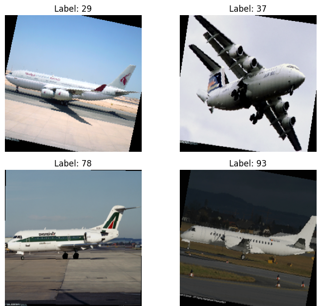
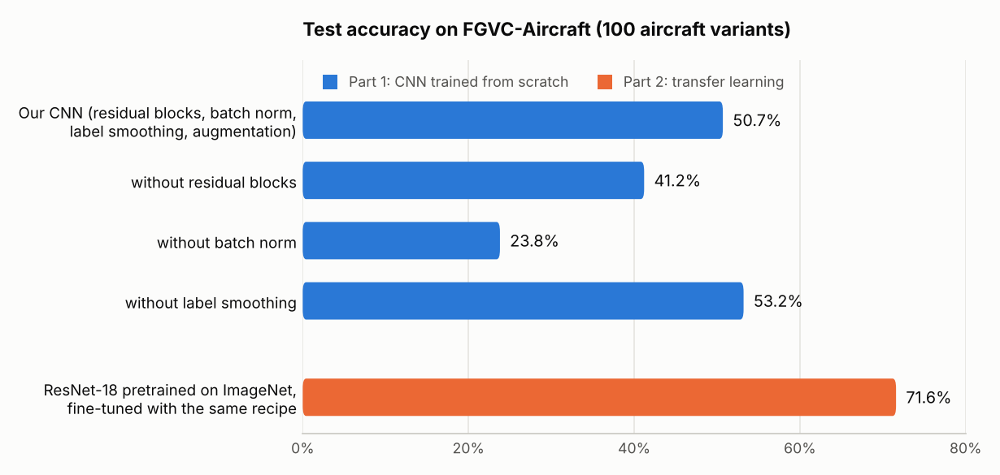
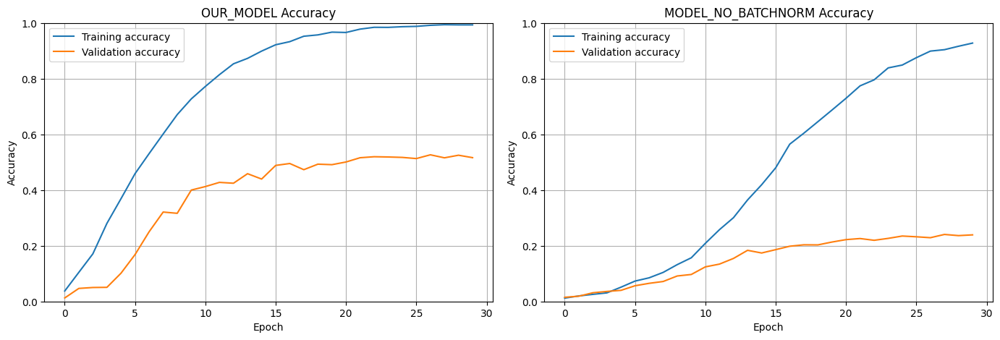

# Aircraft classification: an ablation study and transfer learning

Can you tell a Boeing 737-700 from a 737-800? The [FGVC-Aircraft](https://www.robots.ox.ac.uk/~vgg/data/fgvc-aircraft/) dataset asks exactly this: classify photos into **100 aircraft model variants**. In this project we (1) design a convolutional network from scratch and use an *ablation study* to measure what each design choice contributes, and (2) fine-tune a ResNet-18 pretrained on ImageNet to see how much transfer learning changes the picture.

A group project for the Image Processing and Computer Vision course of the MSc in Artificial Intelligence at the University of Bologna, by **Dorina Dema, Luca De Rosa and Konstantin Kanchev**. Written in PyTorch.

## Results

With 100 classes, random guessing gives 1% accuracy.

## Part 1: design your own network

### Model definition

Our model is a convolutional neural network with residual blocks. We use a standard sequence of 2D-convolution, activation and max-pooling for our convolutional blocks, each of which is followed by a residual block. Finally a simple classifier with two FC layers uses the extracted features to predict the class of images.

The use of Residual Layers is crucial in ensuring that the performance of our model scales with its depth. As explained in the lecture increasing the depth of a network in practice does not always directly yield better generalization and can even worsen results. In theory we can always add identity layers to a network and have a deeper network that performs the same, but in practice deeper layers cannot recover the identity and thus can harm performance. Residual Layers resolve this issue by adding skip connections that on an intuitive level can help us skip these useless layers.

The network is relatively large and thus prone to overfitting, which is why most initial design choices were with the aim of regularizing the model. To this end, we add different kinds of regularization techniques until the goal of 50% accuracy is reached and then conduct an ablation study in order to determine the influence on the performance of our model.

### Main takeaways from the ablation study w.r.t. accuracy

Our ablation study demonstrates the importance of the Residual Layers and Batch Normalization in our network. Without said design choices we observe a drop in accuracy of 0.095 and 0.269 respectively, which is significant considering that the number of possible labels is 100. On the other hand, ablating the label smoothing increases accuracy by 0.025. Meaning that adding label smoothing likely did not improve our model. In a similar fashion, removing data augmentation seems to only slightly increase accuracy.

### A closer look at training behaviour and loss

Looking at the loss per epoch, it is evident that removing **Residual Layers** results in instability at the beginning of training. That said, after the first 5 epochs training seems to stabilize, after which the validation loss follows the training loss similarly to our model.

When removing the **Batch Norm** we observe a more interesting behavior. While validation accuracy increases and is in any case better than random guessing (which would give an accuracy of 0.01) the validation loss varies between epochs but ultimately does not decrease significantly (4.5822 after epoch 1 vs 4.2680 after epoch 30). This could imply that while the model is able to predict the correct class in a significant number of cases (23.8% accuracy in testing), the distributions outputted are not confident and thus result in a high cross-entropy.

In a further experiment we evaluate **removing the Batch Norm layer but also reducing the learning rate**. The reasoning behind this is that Batch Norm smooths the loss landscape and thus in general allows higher learning rates to be used. We wanted to test whether the unsuccessful convergence in the previous experiment was due to the learning rate being too high after removing this smoothing. That said, after reducing the learning rate by a factor of 4 and training for 20 extra epochs we observe basically the same behaviour. We believe that it is possible that reducing the learning rate even more could improve convergence, but even so the added cost of longer training justifies the use of Batch Norm in our network.

Both our original proposal and the variant without **Label Smoothing** exhibit a similar behaviour during training and similar accuracy results. When examining the values of the loss function between the two variants, we notice an inherent property of Label Smoothing, namely that it yields a slightly higher cross-entropy loss due to the soft distribution that it expects.

Finally, **Data Augmentation** seems to be not as significant for our model as we originally expected (it was one of the first decisions we made). The training behaviour of the ablated model closely resembles that of the original one and achieves a similar test loss.

### Comment on other hyperparameters

Other hyperparameters that can be evaluated are the learning rate, number of epochs, batch size and resizing of the images. Even though we do not explicitly do an ablation study on them, we believe that the values we have chosen are suitable and our results are still informative (e.g. in the early stages of our project we did try using different sizes of images, learning rates and number of epochs and we kept using the values that seemed to empirically work "well enough").

## Part 2: fine-tune an existing network

We concatenate ResNet-18 with the same final classifier as before in part 1, which consists of:
1. Flatten layer;
2. Fully connected layer;
3. Batch Norm layer + ReLU;
4. Final fully connected layer, which outputs logits corresponding to the 100 aircraft models.

**Freezing VS Unfreezing the backbone model**: We saw in the lecture that *transfer learning* refers to importing a model with possibly frozen weights. On the other hand, in *fine-tuning* we do **not** freeze the weights, as it would mean in this case only using ResNet-18 generic knowledge. In contrast, we want to specialise the expressive power of ResNet to the aircraft domain, and we obtain that by allowing the weights to be trained on our particular aircraft dataset.

Interestingly, keeping the same hyperparameters as in part 1, we already achieve more than 70% accuracy. We then attempt to improve our result by tweaking the following aspects of the model:
- **Data augmentation**: As explained in the lecture, data augmentation exhibits similar benefits to having a larger dataset. Since ResNet-18 has more parameters than our previous model, we expect it to train better with this added regularization.
- **Modifying the final classifier**: We added an extra fully connected layer to the final classifier, as this could increase the expressiveness of the network.
- **Learning rates and epochs**: Since adding an extra FC layer led to mildly unstable results, we explored the effect of reducing the learning rate and train for longer, for stabilisation purposes.

**1st experiment: introducing data augmentation.** We train the model introducing data augmentation. Surprisingly, we only got slightly better results, with accuracy peaking at 72% before starting to oscillate.

**2nd experiment: adding an extra FC layer, with augmentation.** As one possible explanation for the underwhelming improvement obtained with data augmentation, we tried to increase the model expressive power by adding to the final classifier an extra fully-connected layer. Interestingly, not only the performance did not improve, but the results showed mild instability. We are going to try to address that in the next experiment.

**3rd experiment: extra FC layer with augmentation *and* reduced learning rate.** We addressed the partial instability of the scores in the previous experiment by reducing the learning rate. The model showed very stable but slower convergence, as expected. Since both the loss and the accuracy were monotonically decreasing and increasing, respectively, we decided in the last experiment to increase the number of epochs, to understand if that could be the bottleneck.

**4th experiment: longer training with small learning rate.** We finally keep the small learning rate (2e-5) and train the model for 35 more epochs (hence 65 total). We do so by defining a custom function `continue_training`. The model continues improving, until reaching accuracy of around 70%, which is very similar to the accuracy we obtained with just 30 epochs, with no data augmentation (see 1st experiment). This seems to suggest that neither a lack of expressiveness of the final classifier, nor training time are an obstruction preventing the model to significantly improve.

### Final conclusions

1. **Baseline Fine-Tuning Performance (2A):** By using a pretrained ResNet-18 combined with our initial classifier and training recipe without data augmentation, we immediately surpassed the 70% threshold, reaching over **70% test accuracy** in 30 epochs. This highlights the effectiveness of using high-quality pre-trained weights from ImageNet through transfer learning.
2. **The Impact of Data Augmentation:** Introducing data augmentation (Random Horizontal Flips, Rotations, and Color Jitter) only yielded a marginal improvement, with validation accuracy peaking around **72%**. This indicates that the pre-trained features were already highly representative, making further aggressive regularization less critical for this dataset. It could be interesting to try more diverse augmentation techniques and compare results.
3. **Classifier Complexity vs. Optimization Stability:** Adding an extra fully connected layer to increase the expressive capacity of our network's head actually led to training instability and suboptimal performance when trained with the standard learning rate of `2e-4`.
4. **Optimization and Fine-Tuning with Low Learning Rates:** To address this instability, reducing the learning rate to `2e-5` proved effective. This allowed for stable and monotonic convergence, though at a slower pace. Continuing this training for a total of 65 epochs allowed the model to steadily reach **70% validation accuracy**, which we had already achieved.
5. **Overall Takeaway:** For fine-tuning ResNet-18 on the FGVC-Aircraft dataset, our simpler classifier head with the previous learning rate (2e-4) and no augmentation converges faster and performs comparably to a deeper classification head, which requires a much smaller learning rate and a significantly longer training schedule.

## A note added after the submission

While preparing this repository we noticed a bug in the data loading: the "no augmentation" training set (`train_no_augmentation`) was built with the augmented transform. So the runs labelled *without data augmentation* in the notebook, and the runs that reuse that loader, were in fact trained with augmentation, and the effect of data augmentation was never actually measured. Those runs repeat configurations we had already trained, and the differences between identical setups (up to about 4 points, e.g. 50.7% vs 54.5%) show how much results vary from one training run to the next. The effects of residual blocks and batch norm are well beyond that; the small differences attributed to label smoothing and to augmentation are not. The notebook is left as submitted.

## Running it

The notebook was written for Google Colab with a GPU. The dataset (2.75 GB) is downloaded automatically through torchvision's `FGVCAircraft` class. Trained weights were saved to our Google Drive and are not included, so the 4th fine-tuning experiment, which reloads them, needs the previous experiment to be run first. To run it locally: `pip install -r requirements.txt`, skip the Google Drive cell, then run the notebook top to bottom.

## License

[MIT](LICENSE).

*Sources: lectures 4, 5 and 6 of the course.*
